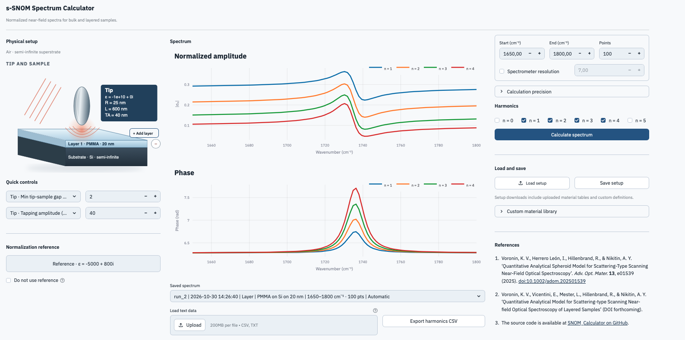

# s-SNOM Spectrum Calculator

A Streamlit application and Python toolkit for calculating normalized scattering-type scanning near-field optical microscopy (s-SNOM) spectra. Model a bulk material or a finite-layer stack, inspect amplitude and phase, and compare calculations with experimental data.



## Model

The tip is a prolate spheroid with apex radius `R` and length `L`, where `L > 2R`. It has a constant complex permittivity.

The sample is one of:

- **Bulk:** a semi-infinite material.
- **Finite layers:** an ordered stack of films on a semi-infinite substrate. Zero-thickness layers are ignored.

Materials can be isotropic or surface-normal uniaxial. The layer engine follows the material symmetry:

- **Isotropic layers:** GICM (generalised image charge method).
- **Uniaxial layers:** FIM (Fourier integral method).

The app adds convergence checks, tapping-cycle gap averaging, and optional spectral broadening around these engines. Direct Python calls expose the underlying harmonic calculations with the numerical settings supplied by the caller. See [numerical models](docs/numerical-models.md) for method details and validation scope.

## Features

- Plot amplitude and phase spectra for selected harmonics and keep a session history of calculation runs.
- Import experimental spectra and compare them with calculated results. Adjust imported phase by an offset or linear tilt, and optionally unwrap it.
- Pick materials from the Standard Catalog, a constant ε, or the Custom Catalog. New Custom Catalog materials can be defined as a constant, a Lorentz model, or an uploaded table. The Custom Catalog can be edited, imported, and exported.
- Save a setup to JSON and load it later, including selected custom definitions and uploaded material tables.
- Export calculated spectra to CSV with calculation and material metadata.

The built-in catalog comes from the shared [Materials Library](https://github.com/vicentini-edoardo/Materials_Library). Uploaded material tables must cover the requested calculation range. See [material and data formats](#material-and-data-formats).

### Numerical precision

Choose one of three modes:

- **Automatic** picks each material's oscillator strength (Weak, Strong, Very strong) from max |β|, β = (ε − 1)/(ε + 1), over the frequency window ± 50 cm⁻¹. Weak is below 5; Very strong starts at 20 (isotropic) or 40 (uniaxial).
- **Presets** applies the strength you choose to every material.
- **Custom** sets M, N and (for isotropic films) K by hand. The quadrature order follows N.

In Automatic and Presets, M and N depend on each material's type (isotropic or uniaxial), whether it is a film or bulk, and its distance from the tip. That distance is the gap for the top layer, and the gap plus the thickness above for a buried layer or the substrate. The app uses the largest M and the largest N over the stack. Where no default converges, it warns and uses the Custom settings.

When the M vs M/2 or N vs N/2 convergence error exceeds 20%, the app plots the computed spectra, shows the error, and asks whether to double that parameter. An accepted M refinement reuses the calculated tapping heights and solves only the new points. Above M = 64 the tip is solved at 33-129 log-height nodes and interpolated, so raising M costs no new solves. The app asks again while the error still exceeds 20%. **Keep current M** (or **Keep current N**) keeps the current result. When the tip shape does not allow twice the current N, the app only warns and keeps it. The 20% threshold is an empirical value that should keep the error of the final calculated spectra within 5%.

## Install and run locally

### Quick start

On Windows or macOS:

1. Download and unzip the repository.
2. Double-click **Install_SNOM_Calculator_Windows.bat** (Windows) or **Install_SNOM_Calculator_macOS.command** (macOS). The launcher prepares a local Python environment and opens the app at <http://localhost:8501>. The first run needs internet access to install Python packages.
3. Afterwards, start the app with **Open_SNOM_Calculator_Windows.bat** or **Open_SNOM_Calculator_macOS.command**. It starts Streamlit directly without installing anything.

**macOS security warning.** macOS may refuse to open a `.command` launcher because it comes from the internet and is not from an identified developer. To allow it:

1. Double-click the launcher once. When macOS shows the warning, click **Done** (do not move it to the Bin).
2. Open **System Settings → Privacy & Security** and scroll down to the **Security** section.
3. Find the message that the launcher "was blocked to protect your Mac" and click **Open Anyway**.
4. Enter your password or use Touch ID, then click **Open Anyway** in the confirmation dialog.

You only need to do this once for each launcher (Install, Open and Update Material Library). On older macOS versions, right-click the launcher and choose **Open**, then confirm.

No desktop launcher is created; make a shortcut (Windows) or alias (macOS) to the Open launcher instead. After moving the folder, run the Install launcher once to repair the environment (internet may be required) and recreate any shortcut.

To update the built-in material catalog, close the app, double-click **Update_Material_Library_Windows.bat** (Windows) or **Update_Material_Library_macOS.command** (macOS), then restart the app. Run the installer once before using the updater. Internet access is required; Git is not needed.

For details and troubleshooting, see the [local install guide](docs/install-guide.md).

### Manual install

Requires Python 3.11–3.13 (3.13 recommended) and access to GitHub for the material catalog dependency. On Intel Macs, follow the [install guide](docs/install-guide.md#4-install-the-dependencies) instead:

```bash
git clone https://github.com/vicentini-edoardo/SNOM_Calculator.git
cd SNOM_Calculator
python3.13 -m venv .venv
source .venv/bin/activate                 # Windows PowerShell: .venv\Scripts\Activate.ps1
python -m pip install -c constraints.txt setuptools wheel
python -m pip install --no-build-isolation -r requirements.txt
streamlit run app.py
```

On Windows, create the virtual environment with `py -3.13 -m venv .venv`. The app opens at <http://localhost:8501>.

### Saving files and custom materials

The local launchers set two options. For manual local runs, set them yourself before starting Streamlit:

- **`SNOM_NATIVE_SAVE_DIALOG=1`** opens a system **Save As** dialog for exported data, setups, material libraries, and material JSON. Enable it only when the server runs on your own computer. Hosted runs use browser downloads; enable your browser's "ask where to save" setting to choose a folder. Restart the app with the launcher to enable the dialog.
- **`SNOM_MATERIAL_LIBRARY_FILE`** names a JSON file that stores custom materials and loads them at startup. The launchers use `custom_material_library.json` beside the launcher, which Git ignores. Creating, editing (including quick parameter edits), importing, renaming, or deleting a material updates the file. Example: `SNOM_MATERIAL_LIBRARY_FILE="$PWD/custom_material_library.json" streamlit run app.py` (PowerShell: `$env:SNOM_MATERIAL_LIBRARY_FILE="$PWD\custom_material_library.json"; streamlit run app.py`).

Leave `SNOM_MATERIAL_LIBRARY_FILE` unset on Streamlit Cloud to keep the browser-session library. To migrate session materials, export the library JSON and import it once in the local app. Keep a backup of the file, and run one local app at a time to avoid competing writes.

## Python and Jupyter notebook

The calculation engines work without Streamlit. Install the package and JupyterLab in the active environment:

```bash
python -m pip install -e . jupyterlab
python -m jupyterlab examples/engine_spectra.ipynb
```

Select a kernel from that environment. The [example notebook](examples/engine_spectra.ipynb) shows tip, sample, and reference definitions, bulk and finite-layer calculations, and amplitude/phase plots across harmonics.

`calculate_bulk_harmonics`, `calculate_layer_harmonics` and `calculate_stack_harmonics` (films ordered from the tip to the substrate) return a dictionary of `SpectrumResult` objects keyed by harmonic order. Each result holds NumPy arrays for amplitude, phase, and complex signals. These calls use the supplied numerical settings; they do not apply the app's convergence checks, gap averaging, or spectral resolution.

Harmonic 0 is the cycle-average dipole response, evaluated over the same heights as other harmonics. At zero tapping amplitude, higher harmonics have zero sample and reference signals, so normalized contrast, amplitude, and phase are `NaN`.

## Material and data formats

Material tables can be CSV or whitespace-delimited, with or without a header. Isotropic and uniaxial tables can use:

```text
frequency_cm1,eps_real,eps_imag
```

Uniaxial tables can instead give separate parallel and perpendicular permittivities:

```text
frequency_cm1,eps_parallel_real,eps_parallel_imag,eps_perpendicular_real,eps_perpendicular_imag
```

Experimental imports accept amplitude with optional phase in radians, real and imaginary columns, or a complex signal column. For descending wavenumber axes, choose **Reverse row order** during import so frequency and signal columns stay aligned. Imports skip blank lines, comments beginning with `#`, `%`, or `//`, and leading `key: value` or `key = value` metadata lines.

Custom material definitions can include references. Exported spectrum CSV files include calculation settings, sample layers, material definitions and evaluated permittivities, plus any citations supplied with the materials.

## Further information

- [Install guide and troubleshooting](docs/install-guide.md)
- [Numerical models and convergence](docs/numerical-models.md)
- [Development notes](docs/development.md)
- [Contributing](CONTRIBUTING.md)

## Citation

If you use this software, please cite it together with the paper for the model you used:

- **Bulk model:** K. V. Voronin, I. Herrero León, R. Hillenbrand, A. Y. Nikitin, "Quantitative Analytical Spheroid Model for Scattering‐Type Scanning Near‐Field Optical Spectroscopy", *Adv. Opt. Mater.* **13**, e01539 (2025). [doi:10.1002/adom.202501539](https://doi.org/10.1002/adom.202501539)
- **Finite-layer model:** K. V. Voronin, E. Vicentini, L. Mester, R. Hillenbrand, A. Y. Nikitin, "Quantitative Analytical Model for Scattering-type Scanning Near-field Optical Spectroscopy of Layered Samples" (DOI forthcoming).

Releases are archived on Zenodo; cite the DOI of the version you used.

GitHub's "Cite this repository" button reads [`CITATION.cff`](CITATION.cff). The software is released under the [MIT License](LICENSE).
